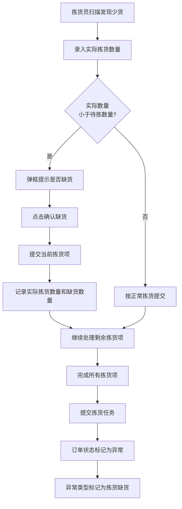
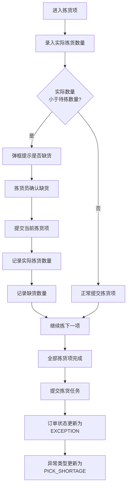
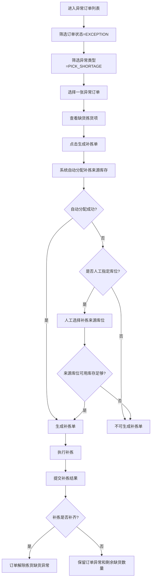

# 出库异常处理方案 / Outbound Exception Handling Plan

<!-- @AI-DOC-VERSION: 2.2 -->
<!-- @AI-LAST-UPDATED: 2026-04-21 -->
<!-- @AI-SCOPE: PDA picking shortage exception handling for WMS outbound operations -->
<!-- @AI-DEPENDS: 出库管理操作流程详解.md -->

---

## 目录 / Table of Contents

- [一、概述 / Part I: Overview](#一概述--part-i-overview)
  - [1.1 目的与范围](#11-目的与范围)
  - [1.2 异常分类](#12-异常分类)
- [二、异常处理流程 / Part II: Exception Handling Processes](#二异常处理流程--part-ii-exception-handling-processes)
  - [2.1 PDA拣货时少货](#21-pda拣货时少货)
  - [2.2 拣货缺货提交与闭环](#22-拣货缺货提交与闭环)
  - [2.3 人工生成补拣单](#23-人工生成补拣单)
  - [2.4 PC端拣货异常管理界面](#24-pc端拣货异常管理界面)
- [三、附件 / Part III: Appendix](#三附件--part-iii-appendix)

---

## 一、概述 / Part I: Overview

<!-- @AI-CONTEXT: Overview of exception handling plan for outbound operations -->

### 1.1 目的与范围

**目的 (Purpose)**

本次文档制定WMS出库PDA拣货少货异常处理方案，明确拣货员发现短拣后的PDA操作、缺货确认、数量记录、订单异常标记和后续闭环规则。

**范围 (Scope)**

本方案适用于WMS出库PDA拣货少货异常处理，包括：
- PDA拣货环节
- 异常提交与闭环环节
- 异常订单人工补拣环节
- PC端拣货异常管理环节

### 1.2 异常分类

<!-- @AI-CONTEXT: Exception classification for outbound operations -->

**异常类型分类 (Exception Type Classification)**

| 异常类型 | 描述 | 对应章节 |
|-----|------|------|
| **拣货少货** (PICK_SHORTAGE) | PDA拣货时实际数量少于系统应拣数量 | 2.1 PDA拣货时少货 |

---

## 二、异常处理流程 / Part II: Exception Handling Processes

<!-- @AI-CONTEXT: Detailed exception handling processes for each scenario -->

### 2.1 PDA拣货时少货

<!-- @AI-WORKFLOW: PDA picking shortage exception handling -->

**触发条件 (Trigger Conditions)**
- PDA拣货过程中，实际库存少于系统记录数量
- 拣货员扫描库位SKU后，实际找到的数量不足

**检测方式 (Detection Method)**
- PDA扫描验证：拣货员确认实际可拣数量

**处理流程 (Handling Process)**



**处理规则 (Handling Rules)**

| 处理步骤 | 操作说明 | 责任人 | 系统动作 |
|---------|---------|-------|---------|
| 发现少货 | 拣货员在PDA录入当前拣货项的实际拣货数量 | 拣货员 | 系统比对待拣数量与实际数量 |
| 确认缺货 | 实际数量小于待拣数量时，弹框提示是否缺货，拣货员点击确认缺货 | 拣货员 | 当前拣货项进入缺货提交流程 |
| 提交拣货项 | 提交当前拣货项时，记录实际拣货数量和缺货数量 | 拣货员 | 更新拣货项执行结果 |
| 完成任务 | 拣货员完成所有拣货项后统一提交拣货任务 | 拣货员 | 订单状态标记为异常，异常类型标记为拣货缺货 |

**版本约束 (Version Scope)**

- PDA首拣过程不查找替代库位
- 系统不自动创建补拣任务，补拣单只能由人工筛选异常订单后生成
- 当前版本由拣货员先完成剩余拣货项，再统一提交异常结果
- 第一版补拣执行闭环由PC端手动标记已补齐完成，不新增PDA补拣执行入口

### 2.2 拣货缺货提交与闭环

<!-- @AI-WORKFLOW: Pick shortage submission and closure -->

### 2.2.1 触发条件

**触发场景 (Trigger Scenarios)**
- PDA拣货时，当前拣货项实际数量小于待拣数量
- 拣货员在PDA弹框中确认当前拣货项缺货

### 2.2.2 提交流程

**核心原则 (Core Rules)**

1. ✅ PDA首拣过程不查找替代库位
2. ✅ PDA首拣过程不自动生成补拣任务
3. ✅ 缺货在拣货项提交时记录，在拣货任务完成时统一挂订单异常
4. ✅ 订单异常类型固定为 `PICK_SHORTAGE`

**处理流程 (Handling Process)**



### 2.2.3 数据记录要求

**拣货项记录字段 (Pick Item Record Fields)**

| 字段 | 说明 | 示例 |
|-----|------|------|
| quantity_required | 待拣数量 | 10 |
| actual_picked_qty | 实际拣货数量 | 8 |
| shortage_qty | 缺货数量 | 2 |
| item_exception_flag | 拣货项是否异常 | true |

**库存状态处理规则 (Inventory Status Handling Rules)**

当前 WMS 库存状态字段包括：可用库存、占用库存、异常库存、不良品库存、冻结库存。

PDA 拣货缺货时只记录拣货执行差异，不调整库存状态数量：

| 库存状态 | PDA确认缺货时是否变化 | 说明 |
|---------|--------------------|------|
| 可用 | 不变 | 订单分配时已扣减可用库存，PDA缺货时不把缺货数量释放回可用 |
| 占用 | 减少缺货数量 | PDA确认缺货时，将原短缺库位缺货数量从占用库存扣减 |
| 异常 | 增加缺货数量 | PDA确认缺货时，将原短缺库位缺货数量转入异常库存，避免回到可分配库存 |
| 冻结 | 不变 | PDA拣货缺货不触发冻结 |
| 不良品 | 不变 | PDA拣货缺货不转不良品 |

示例：

```text
A库位原始可用库存：20件
订单计划分配：10件
PDA实际拣货：8件
确认缺货：2件
```

库存状态变化：

```text
1. 分配前
可用：20
占用：0

2. 订单分配10件后
可用：10
占用：10

3. PDA确认缺货后
可用：10
占用：8
异常：2
冻结：不变
不良品：不变

拣货项记录：
actual_picked_qty = 8
shortage_qty = 2

订单结果：
order_status = EXCEPTION
exception_type = PICK_SHORTAGE
```

**订单异常字段 (Order Exception Fields)**

当前代码落地为订单状态 + 独立拣货异常案件两层记录：订单主表只承载 `EXCEPTION` 状态，异常类型、异常环节和补拣进度记录在 `picking_exception_case` 与 `picking_exception_line`。

| 字段/表 | 说明 | 示例 |
|-----|------|------|
| outbound_order.status | 订单状态 | EXCEPTION |
| picking_exception_case.exception_type | 异常类型 | PICK_SHORTAGE |
| picking_exception_case.exception_stage | 异常环节 | PICKING |
| picking_exception_case.remark | 异常备注 | PDA确认缺货 |

### 2.2.4 闭环规则

**闭环要求 (Closure Rules)**

| 场景 | 系统处理 | 人工动作 | 闭环结果 |
|-----|---------|---------|---------|
| 单个拣货项缺货 | 记录实际拣货数量和缺货数量 | 拣货员继续完成剩余拣货项 | 拣货任务可提交 |
| 拣货任务含缺货项 | 提交时订单转异常 | 运营/主管后续处理异常订单 | 订单暂停后续正常出库 |

**说明**

- 拣货员在发现缺货后，不需要跳转查找其他库位
- 缺货判断以当前拣货项提交结果为准，不回写为正常完成
- 订单进入 `EXCEPTION` 后，不再按正常出库链路继续推进

### 2.3 人工生成补拣单

<!-- @AI-WORKFLOW: Manual supplement pick generation for PICK_SHORTAGE orders -->

### 2.3.1 适用范围

补拣单只针对已经进入异常状态的拣货缺货订单生成：

```text
order_status = EXCEPTION
exception_type = PICK_SHORTAGE
```

补拣单由人工在异常订单列表中筛选订单后触发生成。系统不自动扫描异常订单生成补拣单，但在人工触发生成时，默认由系统自动分配补拣来源库存。

### 2.3.2 补拣单生成规则

| 规则 | 说明 |
|-----|------|
| 按订单生成 | 一张异常订单生成一张补拣单，不跨订单合并 |
| 按缺货数量生成 | 补拣数量等于拣货项剩余缺货数量 |
| 只处理缺货行 | 无缺货的订单行不进入补拣单 |
| 系统自动分配来源库存 | 人工触发生成补拣单后，系统按缺货SKU自动查找可用库存并分配补拣来源库位 |
| 人工指定来源库存 | 自动分配失败或业务需要指定库位时，允许人工选择补拣来源库位 |
| 不自动跳库位 | PDA首拣过程不推荐替代库位，补拣来源只在生成补拣单时确定 |

补拣数量计算：

```text
supplement_qty = shortage_qty - supplemented_qty
```

其中：
- `shortage_qty`：PDA确认缺货时记录的缺货数量
- `supplemented_qty`：该拣货项已完成补拣的数量

### 2.3.3 补拣流程



### 2.3.4 库存处理规则

PDA确认缺货时先处理原短缺库位库存，补拣单生成时只处理补拣来源库存。

库存流转：

```text
PDA 确认缺货：
原库位 ALLOCATED -N
原库位 EXCEPTION +N

生成补拣单：
补拣库位 AVAILABLE -N
补拣库位 ALLOCATED +N

补拣完成：
补拣库位 ALLOCATED -N
补拣库位 PICKING +N
```

系统自动分配补拣库存时，按以下条件筛选库存：

| 条件 | 说明 |
|-----|------|
| SKU一致 | 补拣来源库存必须与缺货SKU一致 |
| 仓库一致 | 补拣来源库存必须在当前订单出库仓 |
| 库存状态可用 | 只允许使用可用库存，不使用占用、冻结、不良品库存 |
| 可用数量充足 | 来源库位可用库存必须满足本次补拣数量；不足时可拆分多个库位 |
| 排除原短缺库位 | 默认不再分配原短缺库位，避免重复分配现场已确认缺货的位置 |

自动分配优先级：

```text
1. 优先同批次/同效期要求的库存
2. 优先拣货区库位
3. 优先距离近的库位
4. 优先单库位可满足补拣数量
5. 单库位不足时，允许多库位拆分补拣
```

以原示例为基础：

```text
A库位原始可用库存：20件
订单计划分配：10件
PDA实际拣货：8件
确认缺货：2件
B库位可用库存：5件
系统自动分配B库位补拣2件
```

库存处理：

```text
1. PDA确认缺货后
A库位可用：10
A库位占用：8
A库位异常：2
B库位可用：5

2. 人工生成补拣单后
A库位占用：8
A库位异常：2
B库位可用：3
B库位占用：2

3. 订单维度
订单总占用数量仍为10
其中：A库位8件 + B库位2件
```

处理原则：

| 对象 | 处理 |
|-----|------|
| 原短缺库位 | 将缺货数量从原库位占用库存转入异常库存，形成拣货短缺差异记录 |
| 补拣来源库位 | 自动分配或人工指定后，按补拣数量从可用库存转为占用库存 |
| 订单总占用数量 | 不增加，保持原订单需求数量 |
| 缺货数量 | 补拣完成后扣减对应 `shortage_qty` 的未补齐数量 |

签出处理：

```text
订单签出时：
占用库存减少本次签出数量
可用库存不变
```

### 2.3.5 补拣单字段

| 字段 | 说明 | 示例 |
|-----|------|------|
| supplement_pick_no | 补拣单号 | SP-20260415-001 |
| order_number | 原订单号 | ORD-20260415-001 |
| exception_type | 原异常类型 | PICK_SHORTAGE |
| sku_code | 缺货SKU | SKU-ABC-001 |
| shortage_qty | 原缺货数量 | 2 |
| supplement_qty | 本次补拣数量 | 2 |
| allocation_method | 补拣库存分配方式 | AUTO / MANUAL |
| source_bin_location | 补拣来源库位 | B-01-01 |
| print_status | 打印状态 | NOT_PRINTED / PRINTED |
| print_count | 打印次数 | 1 |
| printed_at | 最近打印时间 | 2026-04-20 10:30:00 |
| completion_method | 补齐方式 | PDA_SUBMIT / MANUAL_MARK |
| manual_completed_by | 手动标记人 | user-001 |
| manual_completed_at | 手动标记时间 | 2026-04-20 11:00:00 |
| manual_complete_remark | 手动标记备注 | 现场确认已补齐 |
| status | 补拣单状态 | PENDING / PICKING / COMPLETED |

### 2.3.6 补拣完成规则

| 场景 | 系统处理 |
|-----|---------|
| 补拣数量等于剩余缺货数量 | 补拣单完成，订单解除 `PICK_SHORTAGE` 异常，进入后续出库流程 |
| 补拣数量小于剩余缺货数量 | 补拣单完成，订单仍为 `EXCEPTION / PICK_SHORTAGE`，保留剩余缺货数量 |
| PC端手动标记已补齐 | 补拣单状态更新为 `COMPLETED`，订单解除 `PICK_SHORTAGE` 异常 |
| 自动分配失败且未人工指定库位 | 不生成补拣单，订单保持 `EXCEPTION / PICK_SHORTAGE` |
| 人工指定库位库存不足 | 不生成补拣单，订单保持 `EXCEPTION / PICK_SHORTAGE` |

### 2.3.7 打印补拣单

补拣单生成成功后支持打印。打印动作只输出纸质作业单，不改变订单状态、补拣单状态和库存数量。

**打印触发入口**

| 入口 | 说明 |
|-----|------|
| 生成补拣单成功后 | 弹窗提示补拣单已生成，支持立即打印 |
| 补拣单列表 | 对已生成的补拣单执行打印或重打 |
| 拣货异常详情 | 在订单已生成补拣单后显示打印入口 |

**打印内容**

```text
补拣单号：SP-20260415-001
订单号：ORD-20260415-001
异常类型：PICK_SHORTAGE
分配方式：AUTO

SKU        来源库位   补拣数量
SKU-ABC    B-01-01    2

条码：SP-20260415-001
```

**打印规则**

| 规则 | 说明 |
|-----|------|
| 仅已生成补拣单可打印 | 未生成补拣单的异常订单不能打印补拣单 |
| 支持重复打印 | 每次打印增加 `print_count` 并更新 `printed_at` |
| 打印不改状态 | 打印不会改变订单、补拣单和库存状态 |
| PDA执行依据 | 拣货员可扫描纸质补拣单号进入补拣任务 |

### 2.3.8 手动标记已补齐

第一版支持 PC 端手动标记已补齐。该动作以人工确认为准，不要求必须先由 PDA 提交补拣结果。

**适用条件**

```text
order_status = EXCEPTION
exception_type = PICK_SHORTAGE
补拣状态 = 已生成 / 部分补齐
```

**处理结果**

| 对象 | 处理 |
|-----|------|
| 补拣单 | 状态更新为 `COMPLETED` |
| 补拣状态 | 更新为已补齐 |
| 剩余缺货数量 | 视为 0 |
| 订单异常 | 解除 `PICK_SHORTAGE` 异常，订单进入后续出库流程 |
| 记录信息 | 记录 `completion_method = MANUAL_MARK`、操作人、操作时间和备注 |

**手动标记弹窗**

```text
┌──────────────────────────────────────────────┐
│ 标记已补齐                                    │
├──────────────────────────────────────────────┤
│ 订单号: ORD-001                              │
│ 补拣单号: SP-20260415-001                    │
│ 剩余缺货数量: 2                              │
│                                              │
│ 备注: [现场确认已补齐____________________]    │
├──────────────────────────────────────────────┤
│ [确认标记已补齐] [取消]                       │
└──────────────────────────────────────────────┘
```

**操作限制**

| 场景 | 页面处理 |
|-----|---------|
| 未生成补拣单 | 不允许手动标记已补齐 |
| 已补齐 | 不允许重复标记 |
| 备注为空 | 不允许提交 |

### 2.4 PC端拣货异常管理界面

<!-- @AI-UI: PC picking exception management screen -->

### 2.4.1 菜单入口

**菜单路径**

```text
异常 > 出库异常 > 拣货异常
```

**页面路由**

```text
/picking-exceptions
```

**页面定位**

PC端拣货异常管理界面用于查询和处理 PDA 拣货缺货产生的异常订单。当前页面只处理：

```text
order_status = EXCEPTION
exception_type = PICK_SHORTAGE
```

### 2.4.2 页面功能范围

| 功能 | 说明 |
|-----|------|
| 查询异常订单 | 按订单号、拣货单号、SKU、仓库、补拣状态、打印状态筛选拣货缺货异常订单 |
| 查看缺货明细 | 查看缺货SKU、待拣数量、实际拣货数量、缺货数量、原库位 |
| 生成补拣单 | 人工选择一张异常订单后，触发生成补拣单 |
| 自动分配库存 | 生成补拣单时，默认由系统自动分配补拣来源库存 |
| 人工指定库存 | 自动分配失败或业务需要时，允许人工指定补拣来源库位 |
| 打印补拣单 | 补拣单生成后，支持打印或重复打印补拣单 |
| 手动标记已补齐 | 第一版支持人工确认补齐，标记后解除拣货缺货异常 |

### 2.4.3 列表页原型

```text
┌──────────────────────────────────────────────────────────────────────────────┐
│ 异常 / 出库异常 / 拣货异常                                                    │
├──────────────────────────────────────────────────────────────────────────────┤
│ 订单号 [____________]  拣货单号 [____________]  SKU [____________]            │
│ 仓库   [____ v]       补拣状态 [全部 v]  打印状态 [全部 v]  [查询] [重置]     │
├──────────────────────────────────────────────────────────────────────────────┤
│ □ 订单号    拣货单号  SKU    原库位   缺货 补拣状态 打印状态 操作             │
│ □ ORD-001   PICK-001  SKU-A  A-01-01  2    未生成   -        查看             │
│ □ ORD-002   PICK-002  SKU-B  A-02-03  2    已生成   未打印   查看 打印 标记补齐 │
│ □ ORD-003   PICK-003  SKU-C  A-03-05  2    部分补齐 已打印   查看 重打 标记补齐 │
├──────────────────────────────────────────────────────────────────────────────┤
│ [生成补拣单] [打印补拣单] [标记已补齐]                                          │
└──────────────────────────────────────────────────────────────────────────────┘
```

**列表字段**

| 字段 | 说明 |
|-----|------|
| 订单号 | 异常订单编号 |
| 拣货单号 | 产生缺货的原拣货任务编号 |
| SKU | 缺货商品 |
| 原库位 | PDA确认缺货时的原分配库位 |
| 待拣 | 当前拣货项待拣数量 |
| 实拣 | 当前拣货项实际拣货数量 |
| 缺货 | 当前剩余缺货数量 |
| 补拣状态 | 未生成 / 已生成 / 部分补齐 / 已补齐 |
| 打印状态 | 未打印 / 已打印 |

### 2.4.4 订单明细抽屉

```text
┌──────────────────────────────────────────────┐
│ 拣货异常详情                                  │
├──────────────────────────────────────────────┤
│ 订单号: ORD-001                              │
│ 异常类型: PICK_SHORTAGE                       │
│ 订单状态: EXCEPTION                           │
│ 拣货单号: PICK-001                            │
├──────────────────────────────────────────────┤
│ 缺货明细                                      │
│ SKU      原库位    待拣  实拣  缺货  已补拣     │
│ SKU-A    A-01-01   10    8     2     0         │
├──────────────────────────────────────────────┤
│ 补拣单号: SP-20260415-001                      │
│ 打印状态: 未打印                                │
├──────────────────────────────────────────────┤
│ 库存结果                                      │
│ A-01-01 占用: 10                              │
│ PDA缺货时不调整库存状态数量                    │
├──────────────────────────────────────────────┤
│ [生成补拣单] [打印补拣单] [标记已补齐] [关闭]   │
└──────────────────────────────────────────────┘
```

### 2.4.5 生成补拣单弹窗

```text
┌──────────────────────────────────────────────────────┐
│ 生成补拣单                                            │
├──────────────────────────────────────────────────────┤
│ 订单号: ORD-001                                      │
│ 缺货SKU: SKU-A                                       │
│ 剩余缺货数量: 2                                      │
│ 分配方式: (●) 系统自动分配  ( ) 人工指定库位           │
├──────────────────────────────────────────────────────┤
│ 自动分配预览                                          │
│ 来源库位     可用库存     本次补拣数量                 │
│ B-01-01      5            2                           │
├──────────────────────────────────────────────────────┤
│ [生成补拣单] [取消]                                    │
└──────────────────────────────────────────────────────┘
```

**弹窗规则**

| 场景 | 页面处理 |
|-----|---------|
| 自动分配成功 | 显示来源库位和补拣数量，允许生成补拣单 |
| 自动分配失败 | 提示无可用库存，允许切换为人工指定库位 |
| 人工指定库位可用库存不足 | 阻止生成补拣单 |
| 已补齐的缺货行 | 不允许重复生成补拣单 |
| 补拣单生成成功 | 提示生成成功，支持立即打印补拣单 |

### 2.4.6 页面操作规则

| 操作 | 规则 |
|-----|------|
| 查询 | 默认只查询 `EXCEPTION / PICK_SHORTAGE` 订单 |
| 查看详情 | 展示订单维度和缺货明细，不修改库存 |
| 生成补拣单 | 人工选择订单后触发，一张订单生成一张补拣单 |
| 自动分配库存 | 生成补拣单时执行，按 2.3.4 库存处理规则占用补拣来源库存 |
| 人工指定库存 | 只作为自动分配失败或业务指定时的补充方式 |
| 打印补拣单 | 仅对已生成补拣单的订单可操作，打印不改变业务状态 |
| 标记已补齐 | 仅对补拣状态为已生成或部分补齐的订单可操作，提交后解除 `PICK_SHORTAGE` 异常 |

---

## 三、附件 / Part III: Appendix

### A: 异常处理流程图汇总

<!-- 各异常场景的流程图已在对应章节中详细描述 -->

### B: 异常处理表单模板

**异常处理记录单模板 (Exception Handling Record Template)**

```json
{
  "exception_id": "EXC-20260129-001",
  "order_number": "ORD-20260129-001",
  "sku_code": "SKU-ABC-001",
  "exception_type": "PICK_SHORTAGE",
  "exception_stage": "PICKING",
  "detected_by": "user-001",
  "detected_at": "2026-01-29T10:30:00Z",
  "root_cause": "PICK_SHORTAGE",
  "resolution": "MARK_ORDER_EXCEPTION",
  "resolved_by": "user-002",
  "resolved_at": "2026-01-29T10:45:00Z",
  "notes": "拣货员在PDA确认缺货，订单已转异常"
}
```

### C: 补拣单模板

```json
{
  "supplement_pick_no": "SP-20260415-001",
  "order_number": "ORD-20260415-001",
  "exception_type": "PICK_SHORTAGE",
  "allocation_method": "AUTO",
  "print_status": "NOT_PRINTED",
  "print_count": 0,
  "printed_at": null,
  "completion_method": null,
  "manual_completed_by": null,
  "manual_completed_at": null,
  "manual_complete_remark": null,
  "items": [
    {
      "sku_code": "SKU-ABC-001",
      "shortage_qty": 2,
      "supplement_qty": 2,
      "source_bin_location": "B-01-01"
    }
  ],
  "status": "PENDING"
}
```

---

<!-- @AI-DOC-END -->
**文档版本**: 2.2
**最后更新**: 2026-04-21
**维护者**: WMS Team
