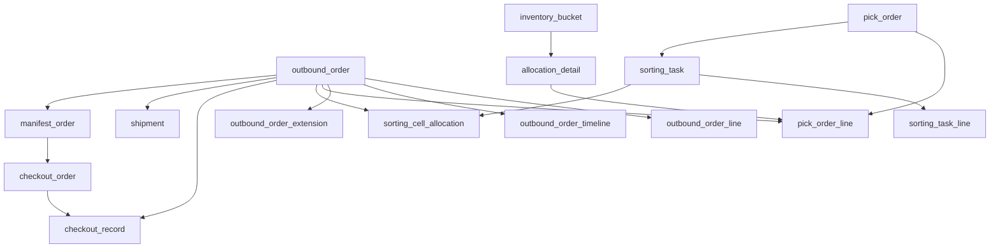
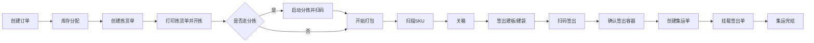

# 出库模块总览与状态机

## 文档说明

- 本目录文档只依据正式业务代码逆向整理。
- 本文不引用旧版 `docs/*.md`、测试代码、E2E 夹具、OpenAPI 文档。
- 当前仓库里正式实现的是 Web 端页面与接口，不存在已落地的 PDA 出库端实现。
- 因此本目录中涉及 PDA 的内容，都是基于 Web 正式实现提炼出的迁移建议，不代表现有 PDA 已支持。
- 结论分为两类：
  - 代码确认结论：能直接从正式路由、服务、模型、页面中确认。
  - 待确认点：代码存在分叉、TODO、未闭环、状态不一致，不能强行解释为统一规则。

## 索引

- [02-订单创建、库存分配与回退.md](./02-订单创建、库存分配与回退.md)
- [03-拣货、分拣与打包.md](./03-拣货、分拣与打包.md)
- [04-签出、集运与发运落库.md](./04-签出、集运与发运落库.md)

当前 Web 端 UI 逆向请看：

- [../outbound-web-reverse/README.md](../outbound-web-reverse/README.md)

## 功能目标

出库模块负责把一张 `outbound_order`（出库订单）从创建，推进到库存分配、拣货、分拣、打包、签出、集运，最终完成出库履约。  
从代码现状看，它不是单一“大事务”，而是多个页面和接口驱动的阶段式流程。

## 模块边界

### 上游输入

- 人工创建出库订单。
- 外部接口创建出库订单。
- 打包环节通过扫描拣货单号、订单号、容器号、格口号进入后续流程。
- 签出环节通过扫描板号或袋号、订单号或运单号推进出库。

### 下游影响

- 改变订单、订单行、时间线、拣货单、分拣任务、签出单、集运单状态。
- 改变库存桶 `inventory_bucket` 和分配明细 `allocation_detail`。
- 产生发货单 `shipment`。
- 消耗包材库存并写入包材流水。
- 更新序列号状态。
- 写操作日志 `operation_logs`。

## 参与对象

### 核心主对象

- `outbound_order`：出库订单主表，整个流程的主业务单据。
- `outbound_order_line`：订单行，记录 SKU 维度的数量推进。
- `outbound_order_timeline`：订单时间线，记录各阶段时间点。
- `pick_order`：拣货单。
- `pick_order_line`：拣货单明细，承接已分配库存的可拣货结果。
- `sorting_task`：分拣任务。
- `sorting_task_line`：分拣任务明细。
- `sorting_cell_allocation`：播种墙格口分配。
- `checkout_order`：签出容器单，板号/袋号级别单据。
- `checkout_record`：签出扫描记录。
- `manifest_order`：集运总单。
- `shipment`：发货单。

### 库存与辅助对象

- `inventory_bucket`：库存桶，真实库存所在位置和桶类型。
- `allocation_detail`：库存分配明细。
- `outbound_order_extension`：订单扩展信息，如渠道、签出重量、物流单号。
- `packaging_material_usage`、`packaging_material_inventory`、`packaging_material_transaction`：包材使用与库存。
- `serial_number`：序列号状态。
- `operation_logs`：操作日志。

## 角色视角

### 订单管理人员

- 在订单列表页创建、查看、修改、删除订单。
- 对订单执行批量分配、批量回退。

### 拣货/分拣/打包人员

- 创建拣货单。
- 打印拣货单并开始拣货。
- 启动分拣，给订单分配格口。
- 在打包页扫描单据和 SKU，完成关箱。

### 签出/集运人员

- 在签出页先建板号/袋号，再扫描订单号或运单号。
- 在集运页先扫集运单，再扫签出单，最后完结集运。

## 页面入口与前端触发方式

### 正式页面入口

- 订单列表：`backend/src/app/(dashboard)/orders/page.tsx`
- 拣货单列表：`backend/src/app/(dashboard)/pick-orders/page.tsx`
- 打包页：`backend/src/app/(dashboard)/packing/page.tsx`
- 打包组件：`backend/src/components/packing/packing-page.tsx`
- 签出页：`backend/src/app/(dashboard)/checkout/page.tsx`
- 签出组件：`backend/src/components/checkout/checkout-page.tsx`
- 集运挂载页：`backend/src/app/(dashboard)/manifest-mount/page.tsx`

### 典型前端动作

- 订单列表页可批量调用库存分配和批量回退。
- 拣货单列表页可批量打印，打印动作会触发开拣。
- 打包页并不是只支持一种扫描入口，而是根据扫描码自动识别为：
  - 拣货单号 `PK-`
  - 订单号
  - 容器号/LPN
  - 格口号
- 签出页是两段式：
  - 先校验板号/袋号。
  - 再反复扫描订单号或运单号。
- 集运挂载页也是两段式：
  - 先校验集运单。
  - 再反复扫描签出单。

## 核心 API 入口

### 订单与分配

- `/api/v1/outbound-orders`
- `/api/v1/outbound-orders/[id]`
- `/api/v1/outbound-orders/batch-allocate`
- `/api/v1/outbound-orders/[id]/rollback`
- `/api/v1/outbound-orders/batch-rollback`

### 拣货与分拣

- `/api/v1/pick-orders`
- `/api/v1/pick-orders/[id]/print`
- `/api/v1/sorting/start`
- `/api/v1/sorting/scan-sku`
- `/api/v1/sorting/complete`

### 打包

- `/api/v1/packing/lookup`
- `/api/v1/packing/[pickOrderId]/start`
- `/api/v1/packing/[pickOrderId]/scan-sku`
- `/api/v1/packing/[pickOrderId]/complete-order`
- `/api/v1/packing/[pickOrderId]/complete`

### 签出与集运

- `/api/v1/checkout/validate`
- `/api/v1/checkout/scan`
- `/api/v1/checkout/confirm`
- `/api/v1/manifest-orders`
- `/api/v1/manifest-mount/validate`
- `/api/v1/manifest-mount/scan`
- `/api/v1/manifest-mount/confirm`

## 主数据关系

## 标准主流程

## 非标准分支

### 分支 1：创建后不一定立即人工分配

- 创建订单后，后端会尝试把该订单加入库存分配队列。
- 同时，前端又支持手工批量分配。
- 因此代码现状是“异步自动分配 + 手工分配”双入口并存。

### 分支 2：打包入口不唯一

- 可从拣货单号进入。
- 可从订单号进入。
- 可从容器号/LPN 进入。
- 可从分拣格口进入。

### 分支 3：标准出库与非标准出库的打包完成逻辑不同

- 标准出库的单订单关箱接口会把订单置为 `PACKED`，并创建 `shipment`。
- 另一条整单完成接口会把订单直接置为 `SHIPPED`，更像退仓、销毁等非标准流程。

### 分支 4：签出扫描即触发发运扣减

- 在代码现状里，`checkout/scan` 不只是“记一条扫描记录”。
- 它会在同一事务里调用签出执行服务，把订单改为 `CHECKED_OUT`，并执行库存发运扣减。

## 状态字典

## `OutboundOrder` 状态

### 代码确认结论

- 常见已使用状态：
  - `CREATED`
  - `PENDING`
  - `ALLOCATED`
  - `OUT_OF_STOCK`
  - `PENDING_PICK`
  - `PICKING`
  - `PICKED`
  - `SORTING`
  - `SORTED`
  - `PACKING`
  - `PACKED`
  - `CHECKOUT_PENDING`
  - `CHECKED_OUT`
  - `SHIPPED`
  - `CANCELLED`
  - `ON_HOLD`
  - `EXCEPTION`

### 代码中的实际含义

- `PENDING`：已创建，可继续分配。
- `ALLOCATED`：库存已转入 `ALLOCATED` 桶，订单行也已标记分配。
- `OUT_OF_STOCK`：分配时库存不足。
- `PENDING_PICK`：拣货单已创建但尚未开拣。
- `PICKING`：打印拣货单后进入。
- `SORTING`：分拣任务启动后进入。
- `PACKING`：打包启动后进入。
- `PACKED`：标准关箱完成。
- `CHECKED_OUT`：签出扫描时进入。
- `SHIPPED`：某些非标准完成路径直接写入。

## `PickOrder` 状态

### 代码确认结论

- 路由和页面里实际出现的状态：
  - `PENDING`
  - `IN_PROGRESS`
  - `PICKED`
  - `SORTING`
  - `PACKING`
  - `COMPLETED`
  - `CANCELLED`

### 说明

- `print` 接口会把 `PENDING -> IN_PROGRESS`。
- `sorting/start` 会把拣货单置为 `SORTING`。
- `packing/start` 会把拣货单置为 `PACKING`。
- 打包完成后，有路径会把拣货单置为 `COMPLETED`。

## `SortingTask` 状态

- `PENDING`
- `IN_PROGRESS`
- `COMPLETED`
- 代码中还会用格口分配和任务明细状态辅助推进，不完全依赖主表状态。

## `CheckoutOrder` 状态

- `PENDING`：板号/袋号已创建但未完结。
- `CHECKED_OUT`：容器已确认签出。
- `MOUNTED`：已挂载到集运单。
- `MANIFESTED`：集运单完结后联动写入。

## `ManifestOrder` 状态

- `CREATED`：已建总单，尚未挂载。
- `IN_PROGRESS`：挂载签出单后由统计服务写入。
- `COMPLETED`：集运完结。
- `CANCELLED`：已取消，不可继续挂载。

## 业务约束总览

- 所有核心查询都带 `tenantId`。
- 订单、拣货单、签出单、集运单都绑定仓库。
- 签出容器与订单必须满足渠道一致性。
- 集运单与签出单必须满足仓库一致性、渠道一致性。
- 回退前要求订单未进波次。
- 拣货单创建要求订单仓库一致且状态允许。
- 分拣启动要求播种墙启用、格口够用。

## 异常/边界总览

- 创建订单时会做订单号并发锁。
- 创建外部单时还会对外部参考号加锁。
- 分配时缺货会直接把订单打成 `OUT_OF_STOCK`。
- 分拣有“墙状态异常自动重置”的兜底逻辑。
- 打包对已关箱订单禁止重复关箱。
- 已签出的板号/袋号禁止重复使用。
- 已绑定到其他集运单的签出单禁止重复挂载。

## 待确认点

- `OutboundOrder`、`PickOrder` 的状态集合在模型注释、校验 schema、路由实际写值之间并不完全一致，应以“路由实际写值”优先。
- 打包存在两条完成路径：
  - `complete-order`：单订单关箱，订单写 `PACKED` 并创建 `shipment`
  - `complete`：整拣货单完成，订单可被直接写成 `SHIPPED`
- 这意味着不同业务类型的“发货完成定义”并未统一。

## 代码依据

- `backend/prisma/schema.prisma`
- `backend/src/app/api/v1/outbound-orders`
- `backend/src/app/api/v1/pick-orders`
- `backend/src/app/api/v1/sorting`
- `backend/src/app/api/v1/packing`
- `backend/src/app/api/v1/checkout`
- `backend/src/app/api/v1/manifest-orders`
- `backend/src/app/api/v1/manifest-mount`
- `backend/src/lib/services/inventory-allocation-service.ts`
- `backend/src/lib/services/checkout-service.ts`
- `backend/src/app/(dashboard)/orders/page.tsx`
- `backend/src/app/(dashboard)/pick-orders/page.tsx`
- `backend/src/components/packing/packing-page.tsx`
- `backend/src/components/checkout/checkout-page.tsx`
