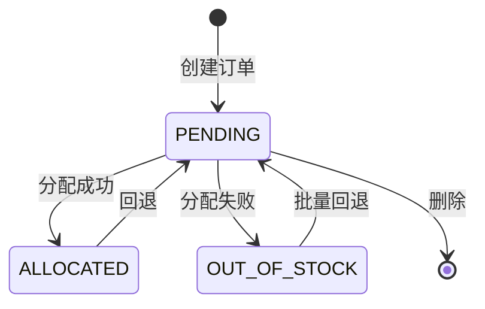

# 订单创建、库存分配与回退

## 功能目标

本文件描述出库订单从“创建”到“分配库存”，以及从“已分配/缺货”回退到“待处理”的正式代码逻辑。

## 入口与触发方式

### 页面入口

- 订单列表页：`backend/src/app/(dashboard)/orders/page.tsx`

### 接口入口

- 创建订单：`POST /api/v1/outbound-orders`
- 查看详情：`GET /api/v1/outbound-orders/[id]`
- 更新订单：`PUT /api/v1/outbound-orders/[id]`
- 删除订单：`DELETE /api/v1/outbound-orders/[id]`
- 批量分配：`POST /api/v1/outbound-orders/batch-allocate`
- 单单回退：`POST /api/v1/outbound-orders/[id]/rollback`
- 批量回退：`POST /api/v1/outbound-orders/batch-rollback`

## 前置条件

### 创建订单

- 登录成功。
- `clientId` 属于当前租户。
- `warehouseId` 属于当前租户。
- 订单行中的 `skuId` 都存在，且属于该客户。

### 分配库存

- 订单状态必须是 `CREATED` 或 `PENDING`。
- 必须存在可用库存。

### 回退库存

- 单单回退要求订单状态是 `ALLOCATED`。
- 批量回退放宽到 `ALLOCATED` 或 `OUT_OF_STOCK`。
- 都要求 `waveId` 为空，即未加入波次。

## 操作步骤

## 1. 创建订单

### 前端触发动作

- 页面提交订单头和订单行。
- 或由外部调用方通过外部接口提交。

### 后端处理顺序

1. 校验登录、租户、客户、仓库、SKU。
2. 基于仓库生成订单号，且对订单号生成加分布式锁。
3. 计算订单级汇总值：
   - `totalOrderedQty`
   - `totalSkuCount`
   - 自动推导 `orderType`
4. 先创建 `order_address`。
5. 再创建 `outbound_order`。
6. 批量写入 `outbound_order_line`。
7. 创建 `outbound_order_timeline` 空记录。
8. 提交事务后，尝试把订单加入库存分配队列。
9. 写一条订单创建日志。

### 写库明细

#### 表 `outbound_order`

- 写入主键、租户、客户、仓库、订单号。
- `referenceNumber` 按请求写入。
- `platform` 固定写 `MANUAL`。
- `platformOrderId` 写前端 `platformOrderNumber`。
- `orderBusinessType` 直接取请求里的 `orderType`。
- `orderType` 写自动推导出的结构类型，不是原请求值。
- `orderSource` 按请求写入。
- `status` 强制写 `PENDING`。
- `outbound_address_id` 绑定刚创建的地址。
- `totalOrderedQty`、`totalSkuCount` 写汇总值。
- `notes`、`config`、`createdBy`、`updatedBy` 写入。

#### 表 `outbound_order_line`

- 每行写：
  - `lineNumber`
  - `skuId`
  - `skuCode`
  - `skuName`
  - `orderedQty`
  - `uomId`
  - `uomCode`
  - `unitPrice`
  - `lineAmount`
  - `batchNumber`
  - `status = PENDING`

#### 表 `outbound_order_timeline`

- 只创建空骨架记录。
- 创建时不写分配、拣货、打包、签出时间。

#### 表 `operation_logs`

- 创建事务外写日志。
- `entityType = OUTBOUND_ORDER`
- `operationType = CREATE`
- `afterStatus = PENDING`

### 业务规则

- 创建时虽然模型默认状态是 `CREATED`，但路由实际写入 `PENDING`。
- 订单结构类型由代码自动判定：
  - 单 SKU 单件
  - 单 SKU 多件
  - 多 SKU
- 创建成功后不会同步直接分配，而是“尝试入队分配”。

### 异常/边界

- 订单号重复直接报错。
- 并发创建通过分布式锁保护。
- 加入分配队列失败不会回滚订单创建，只会打印错误。

## 2. 查询订单详情

### 后端查询范围

- 查询主单、客户、仓库、波次、订单行、地址、扩展、时间线、发货单。

### 关键用途

- 给前端展示数量推进：
  - `orderedQty`
  - `allocatedQty`
  - `pickedQty`
  - `packedQty`
  - `shippedQty`
- 给后续操作判断当前阶段。

## 3. 修改订单

### 可修改范围

- 参考号
- 平台订单号
- 订单业务类型
- 优先级
- 地址
- 配送方式
- 预计时间
- 备注
- `config`

### 不可修改状态

- `PICKING`
- `PICKED`
- `SORTING`
- `SORTED`
- `PACKING`
- `PACKED`
- `CHECKOUT_PENDING`
- `CHECKED_OUT`
- `CANCELLED`

### 写库明细

#### 表 `outbound_order`

- 只更新请求提供的字段。
- 总数量字段不在此接口重算。

#### 表 `outbound_order_address`

- 只有请求包含地址时才更新。

### 边界

- 订单进入执行态后禁止修改，避免影响分配、拣货、签出一致性。

## 4. 删除订单

### 删除条件

- 只允许删除 `PENDING` 状态订单。

### 写库明细

- 直接删除 `outbound_order`。
- 因订单行与订单存在级联关系，相关从表会随之删除。

### 边界

- 已分配、已拣货、已打包订单都不可删除。

## 5. 批量库存分配

### 前端触发动作

- 订单列表页选择多条订单，点击批量分配。

### 后端处理顺序

1. 校验 `orderIds` 非空。
2. 只查询当前租户订单。
3. 检查所有订单必须为 `PENDING`。
4. 对每张订单依次调用 `allocateInventorySync`。

### 分配算法

1. 先按订单行校验可用库存是否足够。
2. 读取客户仓库配置和客户配置，得到：
   - `strategy`：`FIFO` / `FEFO` / `LIFO`
   - `mode`：`FAST` / `FAIR`
3. 在事务里按订单行逐个处理。
4. 从 `AVAILABLE` 桶挑选可分配桶。
5. 对每个分配片段：
   - 生成库存事件。
   - `inventory_bucket` 从 `AVAILABLE` 扣减。
   - `inventory_bucket` 向 `ALLOCATED` 增加。
   - 创建 `allocation_detail`。
6. 更新订单行已分配数量。
7. 更新订单总分配数量。
8. 更新订单状态为 `ALLOCATED`。
9. 更新时间线 `allocatedAt`、`allocatedBy`。
10. 写操作日志。

### 写库明细

#### 表 `inventory_bucket`

- 原桶：
  - `bucketType = AVAILABLE`
  - `quantityDelta = -allocateQty`
- 目标桶：
  - `bucketType = ALLOCATED`
  - `quantityDelta = +allocateQty`
- 桶维度保留：
  - `locationId`
  - `skuId`
  - `batchNumber`
  - `lpn`
  - `asnNumber`
  - `fifoDate`
  - `expiryDate`

#### 表 `allocation_detail`

- 创建一条或多条分配明细。
- 关键字段：
  - `bucketId`
  - `locationId`
  - `skuId`
  - `allocatedQty`
  - `referenceType = OUTBOUND_ORDER`
  - `referenceId = 订单ID`
  - `referenceLineId = 订单行ID`
  - `allocationType = SOFT`
  - `status = ALLOCATED`

#### 表 `outbound_order_line`

- `allocatedQty += lineAllocatedQty`
- `status = ALLOCATED`

#### 表 `outbound_order`

- `totalAllocatedQty += totalAllocated`
- `status = ALLOCATED`

#### 表 `outbound_order_timeline`

- `allocatedAt = now`
- `allocatedBy = 当前用户`

#### 表 `operation_logs`

- 成功分配写 `ALLOCATE`
- 缺货写 `ALLOCATE_FAIL`
- 同时把订单标记缺货时写 `MARK_OUT_OF_STOCK`

### 业务规则

- 分配前订单状态必须在 `CREATED` 或 `PENDING`。
- 批量接口外层又要求是 `PENDING`，所以人工批量分配实际只接受 `PENDING`。
- 分配粒度不是“按单一次性锁定”，而是按订单行拆分到库存桶。

### 异常/边界

- 任意订单状态非法，整批拒绝。
- 任意订单库存不足，会把该单改为 `OUT_OF_STOCK`。
- 订单锁通过 `withAllocationLock` 控制，防止重复分配。

## 6. 回退订单

### 单单回退

#### 后端处理顺序

1. 校验订单存在。
2. 校验状态必须是 `ALLOCATED`。
3. 校验未加入波次。
4. 调用 `deallocateInventorySync`。
5. 回写备注中的回退原因。
6. 记录回退日志。

### 批量回退

#### 后端处理顺序

1. 校验订单存在。
2. 校验状态必须是 `ALLOCATED` 或 `OUT_OF_STOCK`。
3. 校验 `waveId` 为空。
4. 逐单调用 `deallocateInventorySync`。
5. 给每单备注追加回退原因。
6. 记录日志。

### 写库明细

#### 表 `allocation_detail`

- 由 `deallocateInventorySync` 负责回退明细状态。
- 预期会释放已分配结果。

#### 表 `inventory_bucket`

- 预期把数量从 `ALLOCATED` 释放回 `AVAILABLE`。

#### 表 `outbound_order`

- 备注字段追加：
  - `回退原因: xxx`
- 状态目标为 `PENDING`。

#### 表 `operation_logs`

- 写 `ROLLBACK`
- `afterStatus = PENDING`

### 业务规则

- 单单回退只接受 `ALLOCATED`。
- 批量回退额外兼容 `OUT_OF_STOCK`，说明代码把“缺货单回退到待处理”也作为一种恢复手段。
- 已加入波次不可回退，必须先脱离波次。

## 状态流转

## 业务约束

- 所有操作均以 `tenantId` 过滤。
- 创建订单必须校验客户、仓库、SKU 三重合法性。
- 分配和回退都要求订单处于特定状态。
- 波次是回退限制条件。

## 异常/边界

- 创建时订单号冲突。
- 批量分配时有订单状态不符。
- 分配时库存不足。
- 回退时订单已进波次。
- 历史数据异常时可能出现：
  - 订单状态是 `ALLOCATED`
  - 但没有可用 `allocation_detail`
  - 此类情况在后续创建拣货单时会被进一步识别

## 代码依据

- `backend/src/app/api/v1/outbound-orders/route.ts`
- `backend/src/app/api/v1/outbound-orders/[id]/route.ts`
- `backend/src/app/api/v1/outbound-orders/batch-allocate/route.ts`
- `backend/src/app/api/v1/outbound-orders/[id]/rollback/route.ts`
- `backend/src/app/api/v1/outbound-orders/batch-rollback/route.ts`
- `backend/src/lib/services/inventory-allocation-service.ts`
- `backend/src/lib/validations/outbound.ts`
- `backend/prisma/schema.prisma`

## 待确认点

- `deallocateInventorySync` 的细节未在本文展开，实际释放字段应以该服务实现为最终准绳。
- 创建订单后“自动进分配队列”是否在生产环境总是启用，需结合任务队列配置确认。
