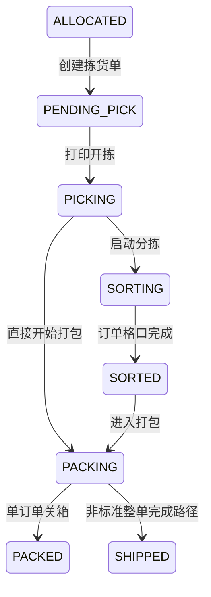

# 拣货、分拣与打包

## 功能目标

本文件描述从“已分配订单”进入“拣货单”，再到分拣、打包、关箱的正式代码流程。

## 入口与触发方式

### 页面入口

- 拣货单列表：`backend/src/app/(dashboard)/pick-orders/page.tsx`
- 打包页：`backend/src/components/packing/packing-page.tsx`

### 接口入口

- 创建拣货单：`POST /api/v1/pick-orders`
- 打印开拣：`POST /api/v1/pick-orders/[id]/print`
- 启动分拣：`POST /api/v1/sorting/start`
- 分拣扫码：`POST /api/v1/sorting/scan-sku`
- 打包查单：`GET /api/v1/packing/lookup`
- 开始打包：`POST /api/v1/packing/[pickOrderId]/start`
- 扫 SKU：`POST /api/v1/packing/[pickOrderId]/scan-sku`
- 单订单关箱：`POST /api/v1/packing/[pickOrderId]/complete-order`
- 整拣货单完成：`POST /api/v1/packing/[pickOrderId]/complete`

## 前置条件

### 创建拣货单

- 订单必须同租户、同仓库。
- 订单状态必须是 `ALLOCATED` 或 `PENDING_PICK`。
- 不能已存在进行中的拣货单。
- 必须存在 `allocation_detail.status = ALLOCATED` 的分配结果。

### 分拣

- 拣货单需处于 `PICKED`、`IN_PROGRESS` 或 `COMPLETED` 的允许状态。
- 播种墙必须启用。
- 可用格口数量必须大于等于订单数量。

### 打包

- 拣货单需能被打包页识别出来。
- `packing/start` 要求拣货单状态是 `IN_PROGRESS`、`PICKED` 或 `COMPLETED`。

## 操作步骤

## 1. 创建拣货单

### 前端触发动作

- 在“创建拣货单”页面选择仓库和订单。

### 后端处理顺序

1. 校验仓库存在。
2. 校验所有订单属于该仓库且状态允许。
3. 检查这些订单是否已有 `PENDING` 或 `IN_PROGRESS` 的拣货任务。
4. 读取 `allocation_detail` 中这些订单的已分配明细。
5. 读取订单行，建立订单行映射。
6. 生成拣货单号。
7. 根据 SKU 数和数量推导 `taskType`。
8. 创建 `pick_order`。
9. 批量创建 `pick_order_line`。
10. 把订单状态从 `ALLOCATED` 改为 `PENDING_PICK`。
11. 更新订单时间线 `pendingPickAt`。
12. 写拣货单和订单日志。

### 写库明细

#### 表 `pick_order`

- 写入：
  - `taskNumber`
  - `taskType`
  - `order_business_type`
  - `status = PENDING`
  - `priority`
  - `assignedUserId`
  - `assignedAt`
  - `pickMethod = PAPER`
  - `pickMode = AGGREGATE`
  - `totalLines`
  - `totalQty`

#### 表 `pick_order_line`

- 每条来自一条 `allocation_detail`。
- 关键字段：
  - `orderId`
  - `orderLineId`
  - `skuId`
  - `skuCode`
  - `locationId`
  - `bucketId`
  - `batchNumber`
  - `lpn`
  - `expectedQty = allocatedQty`

#### 表 `outbound_order`

- 命中 `ALLOCATED` 的订单更新为 `PENDING_PICK`。

#### 表 `outbound_order_timeline`

- `pendingPickAt = now`

#### 表 `operation_logs`

- `PICK_TASK.CREATE`
- `OUTBOUND_ORDER.CREATE_PICK_TASK`

### 业务规则

- 创建拣货单是把“库存分配结果”复制为“可执行拣货任务”。
- 不是按订单行原始数量建任务，而是按实际 `allocatedQty` 建任务。

### 异常/边界

- 如果订单状态已分配，但既没有 `allocation_detail`，也没有 `ALLOCATED` 库存桶，会报历史数据异常。
- 如果订单已存在进行中的拣货单，拒绝再次创建。

## 2. 打印开拣

### 前端触发动作

- 拣货单列表支持打印。
- 打印不是纯打印动作，而是业务上的“开拣”。

### 后端处理顺序

1. 校验拣货单存在。
2. 校验状态必须是 `PENDING`。
3. 更新拣货单为 `IN_PROGRESS`，写 `startedAt`。
4. 找出关联订单。
5. 仅把状态还是 `PENDING_PICK` 的订单改为 `PICKING`。
6. 更新时间线 `pickingStartAt`。
7. 写拣货单日志。
8. 给订单写“开始拣货”日志。
9. 返回打印所需数据。

### 写库明细

#### 表 `pick_order`

- `status = IN_PROGRESS`
- `startedAt = now`

#### 表 `outbound_order`

- `PENDING_PICK -> PICKING`

#### 表 `outbound_order_timeline`

- `pickingStartAt = now`

#### 表 `operation_logs`

- `PICK_TASK.PRINT`
- `PICK_TASK.START_PICK`
- `OUTBOUND_ORDER.START_PICK`

## 3. 分拣启动

### 前端触发动作

- 扫描拣货单号或容器号，选择播种墙，启动分拣。

### 后端处理顺序

1. 校验播种墙启用。
2. 按拣货单号或 LPN 找拣货单。
3. 若拣货单已在别的墙上分拣，直接拒绝。
4. 若墙处于 `SORTING` 但没有进行中任务，自动重置墙和格口。
5. 统计该拣货单下的订单集合。
6. 检查订单数不能超过总格口数。
7. 获取可用格口。
8. 创建 `sorting_task`。
9. 为每个订单分配一个格口，写 `sorting_cell_allocation`。
10. 为每个订单行写 `sorting_task_line`。
11. 更新播种墙状态为 `SORTING`。
12. 更新拣货单状态为 `SORTING`。
13. 更新相关订单状态为 `SORTING`。

### 写库明细

#### 表 `sorting_task`

- `status = IN_PROGRESS`
- `taskNumber`
- `pickOrderId`
- `sortingWallId`
- `totalItems`
- `completedItems = 0`

#### 表 `sorting_cell_allocation`

- 以“订单”为粒度分配格口。
- `status = ALLOCATED`
- `expectedQty = 该订单总待分拣数量`

#### 表 `sorting_task_line`

- 以“订单行/SKU”为粒度创建待分拣行。
- `status = PENDING`

#### 表 `sorting_wall`

- `sortStatus = SORTING`

#### 表 `pick_order`

- `status = SORTING`

#### 表 `outbound_order`

- 相关订单批量写 `SORTING`

### 业务规则

- 一个格口对应一个订单，不是一个 SKU。
- 一个播种墙一次只允许稳定承接一个分拣任务。

### 异常/边界

- 订单数量大于格口数时直接失败。
- 找不到可用格口直接失败。
- 墙状态异常时有自动修复逻辑。

## 4. 分拣扫码

### 前端触发动作

- 在分拣执行中扫描 SKU 条码。

### 后端处理顺序

1. 校验分拣任务存在且 `status = IN_PROGRESS`。
2. 按主条码、SKU 编码、附加条码找 SKU。
3. 找到该 SKU 在任务中第一条未完成的 `sorting_task_line`。
4. `sortedQty + 1`。
5. 若该行够数，则该行 `status = SORTED`。
6. 更新订单对应的 `sorting_cell_allocation`。
7. 若格口够数，则格口分配 `status = COMPLETED`，并更新格口状态。
8. 更新任务 `completedItems`。
9. 若任务完成，则更新：
  - `sorting_task.status = COMPLETED`
  - `pick_order.status = COMPLETED`
  - `sorting_wall.sortStatus = SORTED`
  - 重置格口状态
10. 若某个订单对应格口完成，则该订单写 `SORTED`。

### 写库明细

#### 表 `sorting_task_line`

- `sortedQty += 1`
- 满额后：
  - `status = SORTED`
  - `sortedAt = now`

#### 表 `sorting_cell_allocation`

- `sortedQty += 1`
- 满额后：
  - `status = COMPLETED`
  - `completedAt = now`

#### 表 `sorting_cell`

- 状态在 `SORTING` 和 `COMPLETED` 之间切换。

#### 表 `sorting_task`

- `completedItems += 1`
- 全部完成后：
  - `status = COMPLETED`
  - `completedAt = now`

#### 表 `pick_order`

- 全任务完成后可写 `COMPLETED`

#### 表 `outbound_order`

- 某订单格口完成后写 `SORTED`

## 5. 打包启动

### 前端触发动作

- 打包页扫描后，如果当前拣货单还未进入 `PACKING`，前端会自动调用开始打包接口。

### 支持的扫描对象

- `PK-` 开头：拣货单号。
- 普通订单号：订单模式。
- `BOX-` 或 `CT-`：容器号/LPN。
- `A1`、`B02` 或带后缀的格口码：格口模式。

### 后端处理顺序

1. 校验拣货单存在。
2. 校验状态是 `IN_PROGRESS`、`PICKED` 或 `COMPLETED`。
3. 更新拣货单状态为 `PACKING`。
4. 更新关联订单状态为 `PACKING`。
5. 给每个订单时间线写 `packingStartAt`。

### 写库明细

#### 表 `pick_order`

- `status = PACKING`

#### 表 `outbound_order`

- 关联订单批量 `status = PACKING`

#### 表 `outbound_order_timeline`

- `packingStartAt = now`

## 6. 扫 SKU

### 前端触发动作

- 打包页扫描 SKU 条码。
- 如 SKU 启用序列号管理，前端会弹出序列号扫描对话框。

### 后端处理顺序

1. 校验拣货单处于 `PACKING`。
2. 若扫到的是订单号，则返回订单汇总信息，不进行数量扣减。
3. 否则按条码/SKU 编码找 SKU。
4. 在当前拣货单中找该 SKU 的可打包行。
5. 限制本次打包数量不能超过 `expectedQty - packedQty`。
6. 若是序列号商品：
   - 序列号数量必须等于本次数量
   - 序列号必须存在且状态为 `IN_STOCK`
7. 在事务中更新数量和序列号状态。

### 写库明细

#### 表 `pick_order_line`

- `packedQty += quantity`

#### 表 `outbound_order_line`

- `packedQty += quantity`

#### 表 `outbound_order`

- `totalPackedQty += quantity`

#### 表 `serial_number`

- 对序列号商品：
  - `status = PACKED`
  - `shippedOrderId = 当前订单`

### 业务规则

- 代码明确使用 `expectedQty` 而不是 `pickedQty` 作为打包上限。
- 这意味着系统允许“拣货数量尚未完整回写时继续打包”。

### 异常/边界

- SKU 不在当前拣货单中。
- SKU 已全部打包完成。
- 输入数量超过剩余可打包量。
- 序列号缺失、重复、状态不正确。

## 7. 关箱/完成

## 7.1 单订单关箱 `complete-order`

### 适用场景

- 标准订单打包模式，按订单逐单关箱。

### 后端处理顺序

1. 校验该订单所有打包行 `packedQty >= expectedQty`。
2. 禁止已 `PACKED` 及之后状态重复关箱。
3. 计算包材重量与 SKU 重量，得到最终重量。
4. 生成 `shipmentNumber`。
5. 事务内：
   - 订单写 `PACKED`
   - 订单行写 `PACKED`
   - 时间线写 `packedAt`
   - 释放对应格口
   - 如所有格口都释放，播种墙回到 `IDLE`
   - 维护订单扩展表中的 `checkOutWeightKg`
   - 写包材使用、扣减包材库存、写包材流水
   - 若整张拣货单都已打包完成，则拣货单写 `COMPLETED`
   - 创建一张 `shipment`
6. 事务外写订单操作日志。
7. 返回标签打印数据。

### 写库明细

#### 表 `outbound_order`

- `status = PACKED`
- `totalPackedQty = 汇总后的总打包量`

#### 表 `outbound_order_line`

- `status = PACKED`

#### 表 `outbound_order_timeline`

- `packedAt = now`
- `packedBy = 当前用户`

#### 表 `sorting_cell_allocation`

- `status = RELEASED`

#### 表 `sorting_cell`

- `status = EMPTY`

#### 表 `sorting_wall`

- 如果本分拣任务没有未释放格口：
  - `sortStatus = IDLE`

#### 表 `outbound_order_extension`

- `checkOutWeightKg = finalWeight`

#### 表 `packaging_material_usage`

- 记录订单用了哪些包材、数量、单价、总成本。

#### 表 `packaging_material_inventory`

- `totalQuantity -= quantity`
- `availableQuantity -= quantity`

#### 表 `packaging_material_transaction`

- 写一条 `transactionType = ORDER_OUTBOUND`

#### 表 `pick_order`

- 如果全部行都已打包完成：
  - `status = COMPLETED`
  - `completedAt = now`

#### 表 `shipment`

- 创建新单：
  - `status = CREATED`
  - `orderId = 当前订单`
  - `shipmentNumber`
  - `packageCount = 1`
  - `totalWeightKg = finalWeight`

## 7.2 整拣货单完成 `complete`

### 适用场景

- 更像非标准出库整单完成逻辑。

### 代码现状

- 对非 `STANDARD` 业务类型，会先把未补齐的 `packedQty` 补到 `pickedQty`。
- 然后直接把相关订单写成：
  - `status = SHIPPED`
  - `totalShippedQty = totalPackedQty`
- 还会尝试把序列号改成 `SHIPPED`，但代码里注明“这里需要根据实际业务逻辑确定如何关联序列号”。

### 待确认意义

- 这条路径与单订单关箱相比，更偏向“直接完成出库”，而不是“先关箱再签出”。

## 状态流转

## 业务约束

- 拣货单创建依赖真实分配结果，不依赖订单原始数量。
- 一个订单在同一时刻不能进入多个进行中的拣货单。
- 分拣按订单分配格口。
- 打包支持多种扫描对象。
- 序列号商品必须逐个提交合法序列号。

## 异常/边界

- 历史数据可能出现“订单已分配但没有分配明细”。
- 分拣墙状态异常时会自动修复，不代表数据一定完全正确。
- 标准关箱和整单完成存在两套后续状态推进。

## 代码依据

- `backend/src/app/api/v1/pick-orders/route.ts`
- `backend/src/app/api/v1/pick-orders/[id]/print/route.ts`
- `backend/src/app/api/v1/sorting/start/route.ts`
- `backend/src/app/api/v1/sorting/scan-sku/route.ts`
- `backend/src/app/api/v1/packing/lookup/route.ts`
- `backend/src/app/api/v1/packing/[pickOrderId]/start/route.ts`
- `backend/src/app/api/v1/packing/[pickOrderId]/scan-sku/route.ts`
- `backend/src/app/api/v1/packing/[pickOrderId]/complete-order/route.ts`
- `backend/src/app/api/v1/packing/[pickOrderId]/complete/route.ts`
- `backend/src/components/packing/packing-page.tsx`
- `backend/src/lib/validations/pick-order.ts`
- `backend/prisma/schema.prisma`

## 待确认点

- `pick_order.status` 在模型注释、校验、路由写值之间存在分叉。
- `packing/complete` 中序列号发运关联未完成。
- `packing/complete` 中存在：
  - `TODO: 加入队列推送给外部系统`
  - `TODO: 调用计费接口`
- 标准关箱会创建 `shipment`，整拣货单完成路径是否也应统一创建 `shipment`，代码现状未统一。
