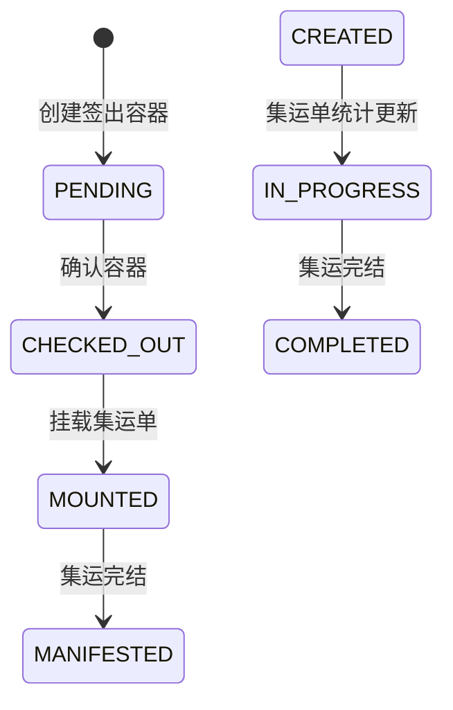

# 签出、集运与发运落库

## 功能目标

本文件描述打包后的订单如何进入签出容器、如何触发库存发运扣减，以及如何挂到集运总单并完结。

## 入口与触发方式

### 页面入口

- 签出页：`backend/src/components/checkout/checkout-page.tsx`
- 集运挂载页：`backend/src/app/(dashboard)/manifest-mount/page.tsx`

### 接口入口

- 校验板号/袋号：`POST /api/v1/checkout/validate`
- 扫码签出：`POST /api/v1/checkout/scan`
- 确认签出容器：`POST /api/v1/checkout/confirm`
- 创建集运单：`POST /api/v1/manifest-orders`
- 校验集运单：`POST /api/v1/manifest-mount/validate`
- 挂载签出单：`POST /api/v1/manifest-mount/scan`
- 完结集运：`POST /api/v1/manifest-mount/confirm`

## 前置条件

### 签出

- 必须先有仓库。
- 必须先校验或创建板号/袋号。
- 被扫订单必须处于 `PACKED` 或 `READY_SHIP`。

### 集运

- 集运单必须存在且状态是 `CREATED` 或 `IN_PROGRESS`。
- 签出单必须存在且状态是 `CHECKED_OUT`。
- 签出单和集运单必须同仓库。
- 若集运单已有渠道，则签出单渠道必须一致。

## 操作步骤

## 1. 校验板号/袋号

### 前端触发动作

- 在签出页先选择仓库和签出类型。
- 输入板号或袋号。

### 后端处理顺序

1. 校验容器号非空。
2. 确定仓库。
3. 查询同仓库、同租户、同容器号的未完结签出单。
4. 若存在，则直接返回已有记录。
5. 若存在同号但状态已 `CHECKED_OUT`，拒绝重复使用。
6. 若不存在，则创建新 `checkout_order`。

### 写库明细

#### 表 `checkout_order`

- 新建时写：
  - `checkoutNumber`
  - `checkoutType`
  - `status = PENDING`
  - `warehouseId`
  - `createdBy`

### 业务规则

- 容器号在同仓库内复用时，会优先回到当前未完结容器。
- 已签出完成的容器号不能复用。

## 2. 扫码签出

### 前端触发动作

- 在已校验的板号/袋号下，持续扫描订单号或运单号。

### 后端处理顺序

1. 校验签出单存在。
2. 用订单号、订单表 trackingNumber、发货表 trackingNumber 识别订单。
3. 校验订单状态只能是 `PACKED` 或 `READY_SHIP`。
4. 推导渠道：
   - 优先 `outbound_order_extension.channel`
   - 否则 `shippingMethod`
5. 对 `checkout_order` 做行锁查询。
6. 检查签出单状态必须是 `PENDING`。
7. 检查该单号或该订单是否已在本签出单中扫描过。
8. 检查该订单是否已绑定到其他签出单。
9. 检查渠道是否与当前签出单一致。
10. 创建 `checkout_record`。
11. 更新签出单统计。
12. 在同一事务中调用 `executeCheckout`。

### “扫码即签出并触发库存扣减”的事务语义

这一步是本模块最关键的代码事实：

- `checkout/scan` 并不是只新增一条扫描记录。
- 它在同一事务里还会：
  - 更新订单状态为 `CHECKED_OUT`
  - 更新时间线
  - 调用发运扣减逻辑
  - 把 `allocation_detail` 改成 `SHIPPED`
  - 更新订单重量/体积

也就是说，库存扣减发生在“扫码签出”阶段，而不是“确认签出容器”阶段。

### 写库明细

#### 表 `checkout_record`

- 新增一条扫描记录：
  - `checkoutOrderId`
  - `sequenceNumber`
  - `scannedNumber`
  - `numberType`
  - `orderId`
  - `orderNumber`
  - `shipmentId`
  - `trackingNumber`
  - `channelName`
  - `channelCode`
  - `scannedBy`

#### 表 `checkout_order`

- 统计字段更新：
  - 首次扫描该订单时 `orderCount + 1`
  - 每扫一次 `parcelCount + 1`
  - 首次形成渠道时写 `channelName/channelCode`

#### 表 `outbound_order`

- 若尚未签出：
  - `status = CHECKED_OUT`
  - `updatedBy = 当前用户`

#### 表 `outbound_order_timeline`

- `checkoutPendingAt = now`
- `checkedOutAt = now`
- `checkedOutBy = 当前用户`

#### 表 `allocation_detail`

- 对当前订单所有相关分配明细：
  - `shippedQty = allocatedQty`
  - `status = SHIPPED`
  - `shippedAt = now`

#### 表 `inventory_bucket`

- 通过 `ship()` 操作把数量从：
  - `ALLOCATED` 或 `PICKING`
  - 扣减为已发运结果
- 实际扣减会带上以下维度：
  - `locationId`
  - `skuId`
  - `batchNumber`
  - `lpn`
  - `asnNumber`
  - `expiryDate`

#### 表 `outbound_order`

- 通过 `updateOrderWeightAndVolume()` 汇总：
  - `totalWeightKg`
  - `totalVolumeCbm`

### 业务规则

- 一张签出单只能承接同渠道订单。
- 同一订单不能同时挂到多个签出单。
- 单次扫码只处理刚扫入的目标订单，不会把整个签出单内所有订单再次重复发运。

### 异常/边界

- 签出单已完结。
- 订单不存在。
- 订单状态不允许签出。
- 订单重复扫描。
- 订单已绑定其他签出单。
- 渠道不一致。

## 3. 确认签出容器

### 前端触发动作

- 点击“完结本板/本袋”。

### 后端处理顺序

1. 校验签出单存在。
2. 校验必须已至少有一条扫描记录。
3. 校验状态必须是 `PENDING`。
4. 把签出单写成 `CHECKED_OUT`。

### 写库明细

#### 表 `checkout_order`

- `status = CHECKED_OUT`
- `checkedOutAt = now`
- `checkedOutBy = 当前用户`

### 说明

- 这里主要是容器级别完结。
- 订单级别的库存扣减、订单状态推进，已经在扫码时完成。

## 4. 创建集运单

### 前端触发动作

- 在集运单列表创建总单。

### 后端处理顺序

1. 校验仓库、渠道编码、渠道名称必填。
2. 根据租户、仓库、渠道生成 `manifestNumber`。
3. 创建 `manifest_order`，状态为 `CREATED`。

### 写库明细

#### 表 `manifest_order`

- `manifestNumber`
- `warehouseId`
- `channelCode`
- `channelName`
- `status = CREATED`
- `createdBy`

## 5. 校验集运单

### 前端触发动作

- 在集运挂载页先扫描集运单号。

### 后端处理顺序

1. 按集运单号查询总单。
2. 校验状态不能是 `COMPLETED` 或 `CANCELLED`。
3. 只允许 `CREATED` 或 `IN_PROGRESS` 继续挂载。
4. 返回已挂载的签出单列表。

## 6. 挂载签出单

### 前端触发动作

- 在已校验的集运单下扫描签出单号。

### 后端处理顺序

1. 校验集运单存在、状态允许。
2. 校验签出单存在。
3. 校验签出单状态必须是 `CHECKED_OUT`。
4. 校验仓库一致。
5. 校验渠道一致。
6. 校验签出单尚未挂载到其他集运单。
7. 更新签出单：
  - 绑定 `manifestOrderId`
  - 状态改 `MOUNTED`
  - 写 `mountedAt`
  - 写 `mountedBy`
8. 查询该签出单下所有订单。
9. 把这些订单的 `manifestOrderId` 批量写入。
10. 事务后调用统计服务更新集运单汇总。

### 写库明细

#### 表 `checkout_order`

- `manifestOrderId = 当前集运单`
- `status = MOUNTED`
- `mountedAt = now`
- `mountedBy = 当前用户`

#### 表 `outbound_order`

- 批量更新：
  - `manifestOrderId = 当前集运单`

#### 表 `manifest_order`

- 由统计服务更新：
  - `orderCount`
  - `parcelCount`
  - `containerCount`
  - `totalWeightKg`
  - `status = IN_PROGRESS`

### 业务规则

- 一个签出单只能挂一个集运单。
- 集运单一旦有渠道，则后续挂入容器必须同渠道。

## 7. 集运完结

### 前端触发动作

- 点击“集运完成”。

### 后端处理顺序

1. 校验集运单存在。
2. 校验不能已完结、已取消。
3. 事务内：
  - 集运单状态改 `COMPLETED`
  - 所有 `MOUNTED` 的签出单改 `MANIFESTED`

### 写库明细

#### 表 `manifest_order`

- `status = COMPLETED`
- `completedAt = now`
- `completedBy = 当前用户`

#### 表 `checkout_order`

- 对挂在该总单下的容器：
  - `MOUNTED -> MANIFESTED`
  - `manifestedAt = now`
  - `manifestedBy = 当前用户`

## 状态流转

## 业务约束

- 签出单以仓库为作用域。
- 集运单也以仓库为作用域。
- 签出和集运都受渠道约束。
- 订单扫码即发运扣减是当前代码最重要的事务语义。

## 异常/边界

- 已签出的板号/袋号不能重用。
- 集运单已完结或已取消不可继续挂载。
- 签出单未签出完成不能挂载。
- 同一签出单不能重复挂多个集运单。

## 代码依据

- `backend/src/components/checkout/checkout-page.tsx`
- `backend/src/app/api/v1/checkout/validate/route.ts`
- `backend/src/app/api/v1/checkout/scan/route.ts`
- `backend/src/app/api/v1/checkout/confirm/route.ts`
- `backend/src/lib/services/checkout-service.ts`
- `backend/src/app/api/v1/manifest-orders/route.ts`
- `backend/src/app/api/v1/manifest-mount/validate/route.ts`
- `backend/src/app/api/v1/manifest-mount/scan/route.ts`
- `backend/src/app/api/v1/manifest-mount/confirm/route.ts`
- `backend/src/app/(dashboard)/manifest-mount/page.tsx`
- `backend/prisma/schema.prisma`

## 待确认点

- `executeCheckout()` 会把订单写成 `CHECKED_OUT`，但某些非标准打包路径又会直接把订单写成 `SHIPPED`，两者并未完全统一。
- `updateOrderWeightAndVolume()` 的体积来自 `recommendedPackagingModel` 对应包材，不是直接根据所有包材使用记录汇总，属于当前实现选择。
