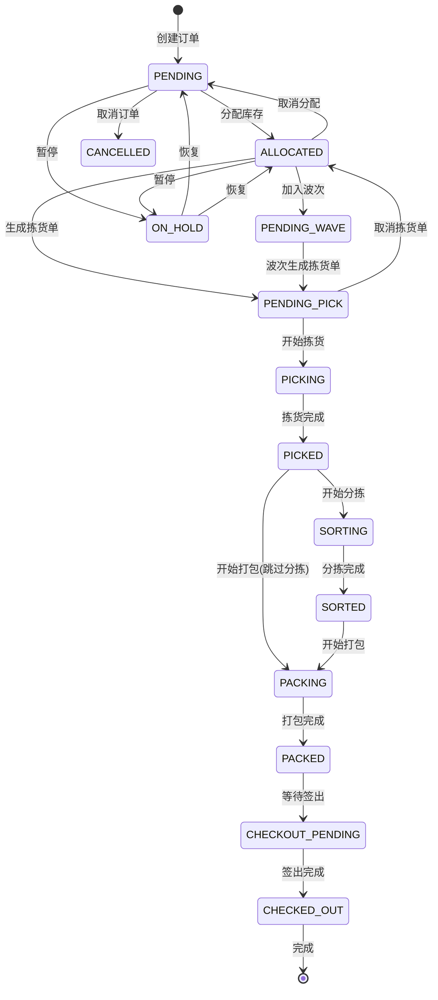

# 出库管理操作流程详解

## 目录

1. [订单状态机](#订单状态机)
2. [完整业务流程](#完整业务流程)
3. [操作流程详解](#操作流程详解)
4. [限制规则](#限制规则)
5. [异常处理](#异常处理)
6. [配置管理](#配置管理)

---

## 订单状态机

### 状态定义

| 状态代码 | 状态名称 | 说明 |
|---------|---------|------|
| PENDING | 待处理 | 订单已创建，等待分配库存 |
| ALLOCATED | 已分配 | 库存已分配，等待生成拣货单 |
| PENDING_PICK | 待拣货 | 拣货单已生成，等待拣货员领取 |
| PICKING | 拣货中 | 拣货员正在执行拣货 |
| PICKED | 已拣货 | 拣货完成，等待分拣或打包 |
| SORTING | 分拣中 | 正在播种墙分拣 |
| SORTED | 分拣完成 | 分拣完成，等待打包 |
| PACKING | 打包中 | 正在打包 |
| PACKED | 已打包 | 打包完成，等待签出 |
| CHECKOUT_PENDING | 待签出 | 等待签出 |
| CHECKED_OUT | 已签出 | 已签出，等待发货 |
| CANCELLED | 已取消 | 订单已取消 |
| ON_HOLD | 暂停 | 订单暂停处理 |

### 状态转换规则



### 状态转换限制

| 当前状态 | 允许转换到 | 操作 | 限制条件 |
|---------|-----------|------|---------|
| PENDING | ALLOCATED | 分配库存 | 库存充足 |
| PENDING | CANCELLED | 取消订单 | 无限制 |
| PENDING | ON_HOLD | 暂停订单 | 无限制 |
| ALLOCATED | PENDING_WAVE | 加入波次 | 波次状态为 CREATED |
| ALLOCATED | PENDING_PICK | 生成拣货单 | 无波次或波次已发布 |
| ALLOCATED | PENDING | 取消分配 | 未生成拣货单 |
| ALLOCATED | ON_HOLD | 暂停订单 | 未生成拣货单 |
| PENDING_PICK | PICKING | 开始拣货 | 拣货员已领取 |
| PICKING | PICKED | 拣货完成 | 所有行已拣货 |
| PICKED | SORTING | 开始分拣 | 需要分拣 |
| PICKED | PACKING | 开始打包 | 不需要分拣 |
| SORTING | SORTED | 分拣完成 | 所有格口已完成 |
| SORTED | PACKING | 开始打包 | 无限制 |
| PACKING | PACKED | 打包完成 | 所有商品已打包 |
| PACKED | CHECKOUT_PENDING | 等待签出 | 无限制 |
| CHECKOUT_PENDING | CHECKED_OUT | 签出 | 无限制 |
| ON_HOLD | PENDING/ALLOCATED | 恢复 | 根据原状态恢复 |

---

## 完整业务流程

### 流程概览

```
